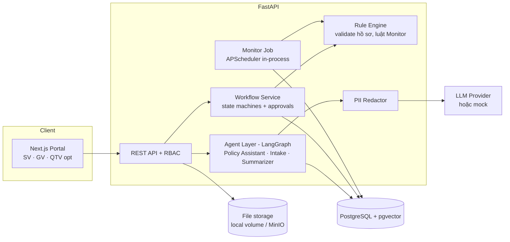
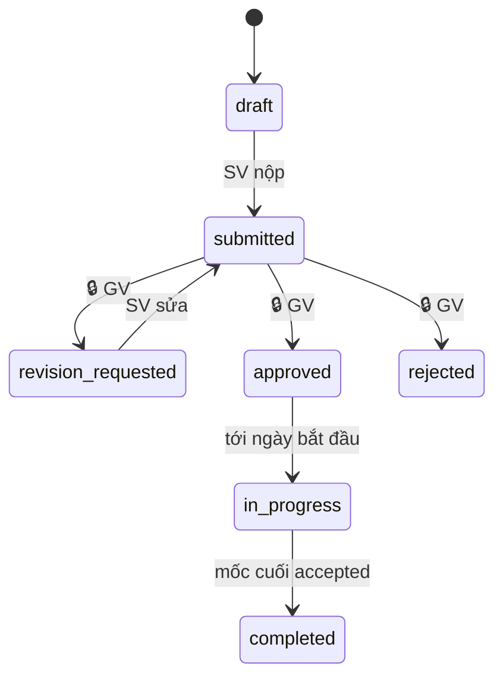
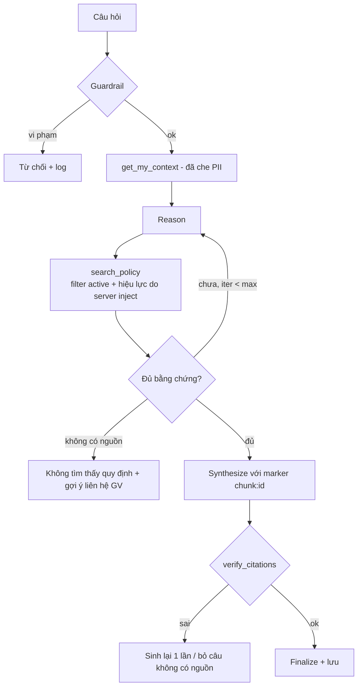
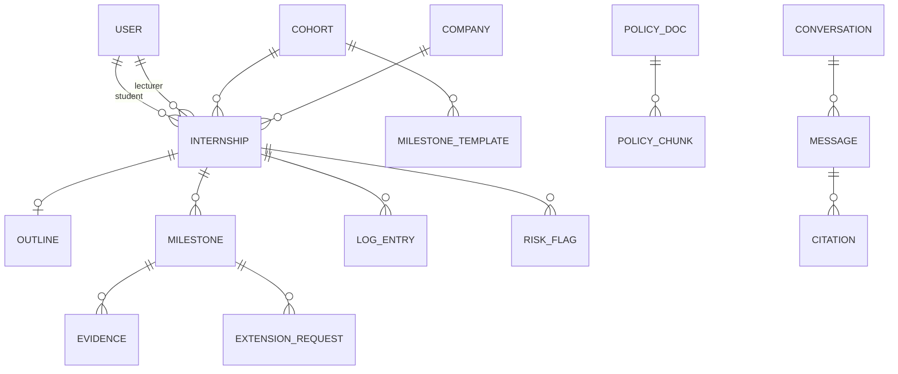

# Design — VIN-15: Hệ thống hỗ trợ thực tập bằng AI

> Kiro spec · Giai đoạn 2/3 · **Phiên bản 2: thu hẹp phạm vi** · Truy vết về `requirements.md` (`R<n>.<m>`).
> Nền tảng: template `mini-agent-studio` (FastAPI + LangGraph ReAct, HITL interrupt, RAG có trích dẫn, mock-first LLM).

## 1. Nguyên tắc thiết kế

1. **AI đề xuất, GV quyết định.** Không tool nào của agent ghi được trạng thái quyết định. Ràng buộc này được enforce ở tầng service.
2. **Xác định trước, LLM sau.** Trạng thái, hạn và luật giám sát đều viết bằng code. LLM chỉ dùng cho: trích xuất hồ sơ, trả lời chính sách, tóm tắt cho GV.
3. **Không có nguồn thì không trả lời.**
4. **Tối thiểu hóa dữ liệu:** che PII trước khi gửi LLM; phân quyền ở tầng repository.
5. **Mock-first và ít hạ tầng:** một lệnh `docker compose up`, chạy được khi không có API key.

## 2. Kiến trúc



| Thành phần | Chọn | Ghi chú |
|---|---|---|
| Frontend | Next.js + shadcn/ui | 3 khu vực theo vai trò |
| Backend | FastAPI (template) | Tái dùng agent graph, HITL, guardrails |
| DB | PostgreSQL 16 + pgvector | Một DB cho cả nghiệp vụ và vector |
| Scheduler | APScheduler trong process API | Không cần Redis/Celery |
| File | Local volume (dev), MinIO (tùy chọn) | URL tải có ký và có hạn |
| Auth | JWT tài khoản demo; OIDC tùy chọn | Keycloak chỉ bật khi cần demo SSO |
| Deploy | Docker Compose: `web`, `api`, `db` | |

## 3. Thành phần

### 3.1 Workflow Service (R2, R3, R4, R12)

Mọi chuyển trạng thái đều đi qua một hàm duy nhất:

```python
def transition(entity, to_state: str, actor: Actor, reason: str | None = None):
    edge = (entity.status, to_state)
    if edge not in STATE_GRAPH[entity.kind]:
        raise InvalidTransition            # -> 409
    if edge in DECISION_EDGES[entity.kind]:
        if actor.kind != "human" or actor.role != "lecturer" or not owns(actor, entity):
            raise ForbiddenTransition      # -> 403
        if to_state in REASON_REQUIRED and not reason:
            raise ReasonRequired           # -> 422
    entity.status = to_state
    audit.append(actor, entity, edge, reason)   # cùng transaction
    events.publish(entity, edge)               # -> Monitor, notification
```

**Hồ sơ thực tập**



**Đề cương:** `draft → submitted → approved | rejected | revision_requested (→ submitted)`. Ba trạng thái cuối do 🔒 GV quyết định.

**Mốc:** `pending → submitted → accepted | rejected (→ submitted)`. Hệ thống chuyển `pending → overdue`. Khi gia hạn được duyệt, `overdue → pending`.

**Yêu cầu gia hạn:** `open → approved | rejected` (🔒 GV), hoặc `open → cancelled` (SV).

### 3.2 Rule Engine (R2.4, R10.2)

Luật viết bằng YAML, đánh giá bằng hàm Python thuần (không dùng `eval` chuỗi):

```yaml
validation:
  - id: min_weeks
    check: duration_weeks_gte
    params: { min: 8 }
    citation: { doc: "QĐ-TT/2025", article: "Điều 5", clause: "Khoản 1" }
monitor:
  - id: due_soon        # R10.2a
    check: milestone_due_within
    params: { days: 3 }
    severity: info
  - id: overdue         # R10.2b
    check: milestone_overdue
    severity: warning
  - id: missing_evidence  # R10.2c
    check: evidence_types_missing
    severity: warning
  - id: low_hours       # R10.2d
    check: cumulative_hours_below_expected
    params: { tolerance: 0.8 }
    severity: warning
```

Mỗi `check` là một hàm trong registry `CHECKS: dict[str, Callable]` và trả về `RuleResult{rule_id, passed, evidence, citation}`.

### 3.3 Agent Layer

| Agent | Dạng | Tools | Ghi DB? |
|---|---|---|---|
| **Policy Assistant** (R8) | ReAct loop của template + node `verify_citations` trước finalize | `search_policy`, `get_my_context` | Chỉ lưu hội thoại |
| **Intake Extractor** (R2.2) | Pipeline: `parse → extract (structured output) → normalize` | parse PDF/DOCX | Không. Trả gợi ý. |
| **Reviewer Summarizer** (R3.2, R12.2) | Một lời gọi LLM, structured output | `search_policy` | Ghi vào `ai_summary` (chỉ hiển thị, không ảnh hưởng quyết định) |



- `search_policy`: hybrid search (pgvector + `tsvector`) trên `policy_chunk`, với điều kiện `doc.status='active' AND effective_from <= today AND (effective_to IS NULL OR effective_to > today)`. Bộ lọc do server gắn, không lấy từ tham số LLM.
- LLM chèn marker `[[chunk:<id>]]`. `verify_citations` đối chiếu marker với tập chunk trong `tool_trace` của lượt, rồi render thành `QĐ-TT/2025 · Điều 5.1 · hiệu lực 01/09/2025`.
- Agent **không có tool ghi** trạng thái nghiệp vụ. Nút "Tạo yêu cầu gia hạn" trong chat chỉ mở form điền sẵn; SV tự gửi qua API thường.

### 3.4 Monitor Job (R10)

- APScheduler chạy hằng ngày lúc 07:00; workflow event cũng gọi `monitor.run_for(internship_id)`.
- Upsert cờ không trùng nhờ unique partial index `(internship_id, flag_type, coalesce(milestone_id, 0)) WHERE status = 'open'`.
- Chạy với `Actor(kind="system")`, nên không thể đi vào `DECISION_EDGES`.
- Thông báo in-app lưu trong bảng `notification`. Gửi email để sau.

### 3.5 PII Redactor (R15.2)

1. Thay các giá trị đã biết của người hỏi (họ tên, MSSV, email, SĐT) bằng placeholder.
2. Dùng regex cho email, SĐT VN, mã số thuế, CCCD.

Bảng ánh xạ placeholder chỉ tồn tại trong bộ nhớ của request.

## 4. Mô hình dữ liệu



| Bảng | Cột chính |
|---|---|
| `user` | id, role, full_name, email, student_code, is_coordinator |
| `cohort` | id, name, start_window, end_window, min_weeks, hours_per_week, outcomes jsonb |
| `company` | id, tax_code unique, name_normalized, address |
| `internship` | id, student_id, lecturer_id, cohort_id, company_id, status, position, job_description, start_date, end_date, mode, mentor_name, mentor_email, ai_fields jsonb, version |
| `outline` | id, internship_id, version, content, ai_summary jsonb, status, decided_by, reason |
| `milestone_template` | id, cohort_id, code, name, due_rule jsonb, required_evidence text[], citation jsonb |
| `milestone` | id, internship_id, template_id, due_at, status, submitted_at |
| `evidence` | id, milestone_id, path, mime, size, sha256 |
| `log_entry` | id, internship_id, week_no, content, hours, review_status, comment |
| `extension_request` | id, milestone_id, requested_due_at, reason, ai_summary jsonb, status, decided_by, decision_reason |
| `risk_flag` | id, internship_id, milestone_id, flag_type, severity, reason, evidence_refs jsonb, status, resolution_note |
| `notification` | id, user_id, kind, payload jsonb, read_at |
| `policy_doc` | id, code, title, effective_from, effective_to, supersedes_id, status, path |
| `policy_chunk` | id, doc_id, path ("Điều 5/Khoản 1"), text, embedding vector, tsv tsvector |
| `conversation`, `message`, `citation` | lịch sử chat + chunk_id đã dẫn |
| `audit_event` | id, at, actor_id, actor_kind, entity, entity_id, action, before jsonb, after jsonb, reason — append-only (trigger chặn UPDATE/DELETE) |

## 5. API

| Method | Path | Vai trò | Req |
|---|---|---|---|
| POST | `/auth/login` · GET `/me` | all | R1 |
| POST/PATCH | `/internships` · POST `/internships/{id}/submit` | SV | R2 |
| POST | `/intake/extract` (multipart) | SV | R2.2 |
| POST | `/internships/{id}/outline` | SV | R3.1 |
| GET | `/approvals/queue` | GV | R3.1 |
| POST | `/internships/{id}/decision` · `/outlines/{id}/decision` | GV 🔒 | R3.3–3.5 |
| GET | `/internships/{id}/milestones` · POST `/milestones/{id}/evidence` | SV/GV | R4, R5 |
| POST | `/internships/{id}/logs` · PATCH `/logs/{id}/review` | SV / GV | R5 |
| POST | `/milestones/{id}/extensions` · POST `/extensions/{id}/cancel` | SV | R12.1 |
| POST | `/extensions/{id}/decision` | GV 🔒 | R12.3–12.4 |
| POST | `/assistant/chat` (SSE) | all | R8 |
| GET/PATCH | `/risk-flags` | GV | R10.7 |
| GET | `/notifications` | all | R10.5 |
| CRUD | `/policies` | QTV / GV điều phối | R9 |
| CRUD | `/admin/cohorts`, `/admin/users` | QTV *(opt)* | R4.1, R1.4 |
| GET | `/internships/{id}/audit` | GV | R12.5 |

## 6. Xử lý lỗi

| Tình huống | Hành vi |
|---|---|
| LLM lỗi hoặc timeout | Chat: báo "tạm thời không trả lời được". Intake: để form trống cho SV tự điền. Tóm tắt cho GV: ẩn đi. Luồng nghiệp vụ không bị chặn. |
| Trích dẫn không kiểm chứng được | Sinh lại 1 lần; sau đó chỉ giữ câu có nguồn. |
| Trích xuất có độ tin cậy thấp | Không điền trường đó, đánh dấu "cần nhập tay". |
| Chuyển trạng thái sai | 409 (cạnh không hợp lệ) / 403 (sai vai trò hoặc là AI) / 422 (thiếu lý do). Mọi trường hợp đều ghi audit. |
| Xung đột phiên bản khi duyệt | 409, yêu cầu tải lại. |

## 7. Correctness properties

| # | Thuộc tính | Req |
|---|---|---|
| P1 | Với mọi `actor.kind ∈ {agent, system}` và mọi cạnh ∈ `DECISION_EDGES`, `transition()` luôn raise. | R3.4, R10.6 |
| P2 | Mọi câu trả lời không phải từ chối đều có tập trích dẫn khác rỗng và ⊆ tập chunk truy hồi trong lượt. | R8.3–8.4 |
| P3 | Mọi chunk truy hồi được đều thuộc văn bản `active` và còn hiệu lực. | R8.1, R9.3 |
| P4 | Chạy Monitor 2 lần liên tiếp trên cùng dữ liệu không làm tăng số cờ đang mở. | R10.4 |
| P5 | SV A không bao giờ đọc được bản ghi của SV B; GV không đọc được SV không được phân công. | R1.3–1.4 |
| P6 | Prompt gửi tới LLM không chứa giá trị PII đã biết của người dùng. | R15.2 |
| P7 | Mỗi thay đổi trạng thái sinh đúng 1 audit event trong cùng transaction. | R3.5, R12.5 |
| P8 | `milestone.due_at` chỉ thay đổi khi có `extension_request` đã `approved` liên kết. | R12.4 |

## 8. Kiểm thử

- **Unit:** bảng cạnh state machine, các hàm `check` của rule engine, PII redactor, `verify_citations`, chunker Điều/Khoản.
- **Property-based (Hypothesis):** P1, P4, P5, P6, P8.
- **Integration (Postgres thật qua testcontainers):** luồng đăng ký → duyệt → mốc → nhật ký → cờ rủi ro → gia hạn → duyệt.
- **Agent:** test với mock LLM (`reason_fn`/`generate_fn` injectable của template). Có một bộ nhỏ khoảng 10 câu smoke test cho trích dẫn và từ chối. Bộ eval đầy đủ (R16) nằm trong Backlog.
