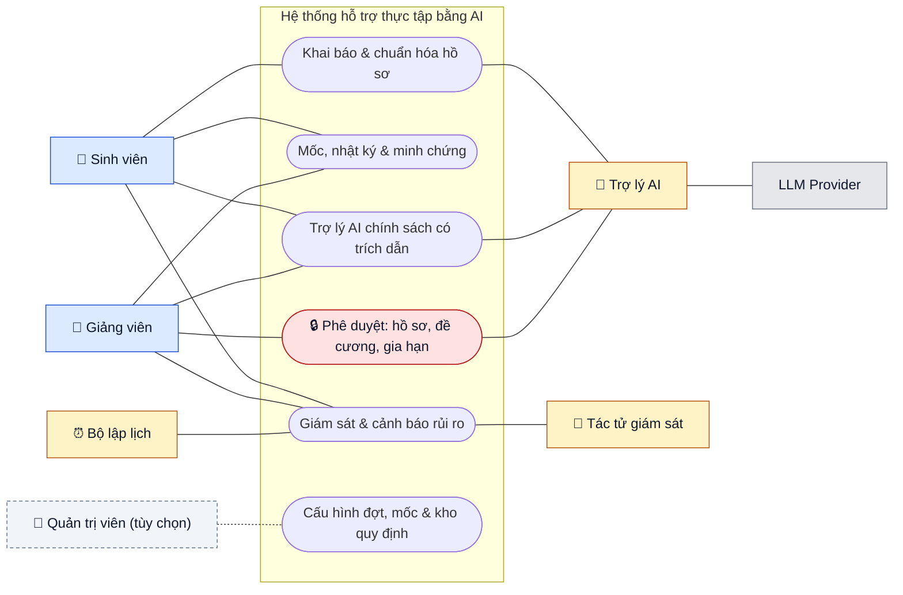
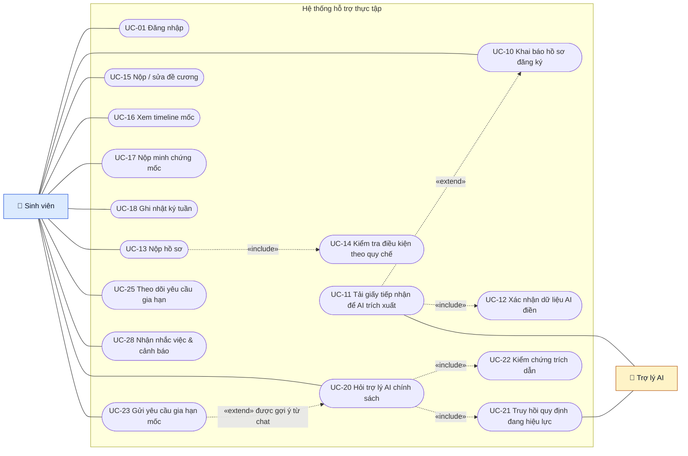
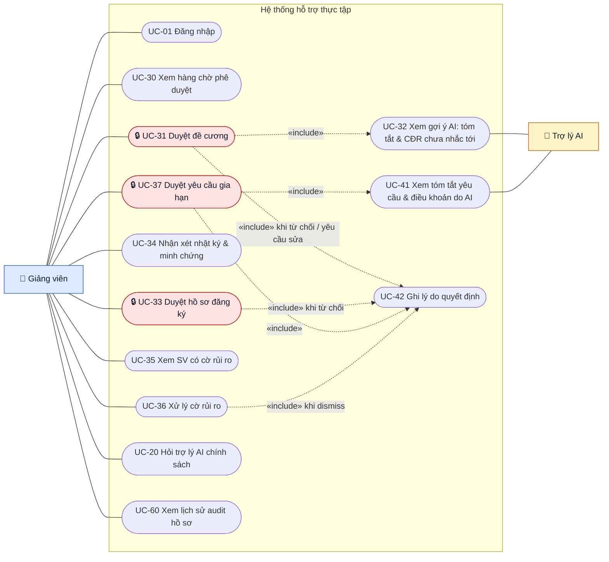
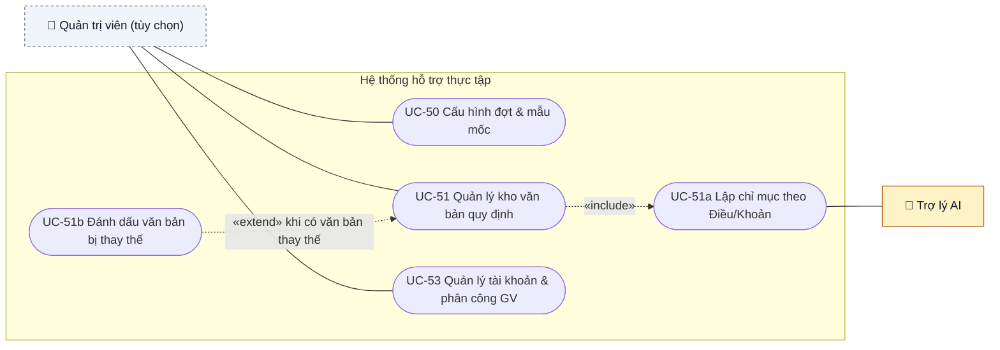
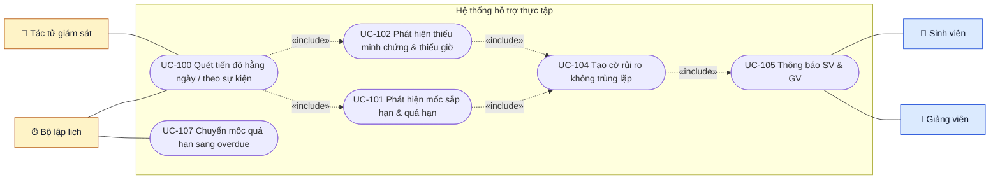
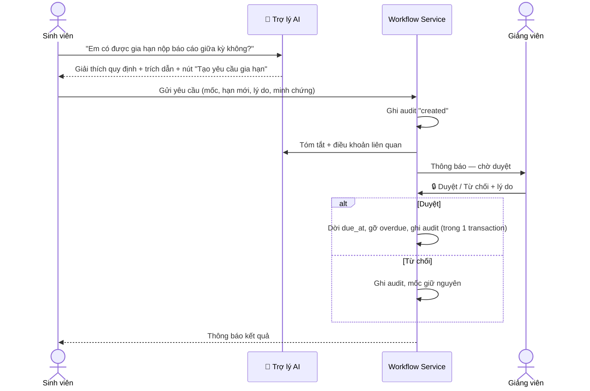

# Use Cases — VIN-15: Hệ thống hỗ trợ thực tập bằng AI

> Phiên bản 2: thu hẹp phạm vi. Bổ sung cho `requirements.md`.
> Ký hiệu: `UC-xx` = use case · `R<n>` = requirement · 🔒 **HITL** = chỉ con người được quyết định.
> Quy ước sơ đồ Mermaid `flowchart`:
> - Hình chữ nhật: tác nhân.
> - Hình bo tròn `([...])`: use case.
> - Mũi tên nét đứt: quan hệ `«include»` / `«extend»`.

---

## 1. Vai trò

### 1.1 Danh sách tác nhân

| Tác nhân | Loại | Xác thực | Phạm vi dữ liệu |
|---|---|---|---|
| **Sinh viên (SV)** | Người — **chính** | JWT demo / OIDC | Chỉ hồ sơ của bản thân |
| **Giảng viên (GV)** | Người — **chính** | JWT demo / OIDC | SV được phân công |
| **Quản trị viên (QTV)** | Người — **tùy chọn** | JWT demo / OIDC | Cấu hình, kho quy định, tài khoản. Không cần xem nội dung nhật ký SV. |
| Trợ lý AI (`AI-ASSIST`) | Hệ thống | Service | Văn bản quy định + ngữ cảnh SV đã che PII |
| Tác tử giám sát (`AI-MONITOR`) | Hệ thống | Service | Đọc mốc, nhật ký. Chỉ ghi cờ rủi ro và thông báo. |
| Bộ lập lịch (`SCHEDULER`) | Hệ thống | — | Kích hoạt job hằng ngày |
| LLM Provider | Ngoài | API key | — |

> **Khi không bật QTV:** đợt, mẫu mốc, tài khoản và phân công GV được nạp từ file YAML/seed. UC-51 (kho quy định) chuyển cho GV có cờ `is_coordinator`.

### 1.2 Chức năng từng vai trò

**① Sinh viên**
- Khai báo hồ sơ đăng ký; tải giấy tiếp nhận để AI trích xuất và chuẩn hóa; xác nhận rồi nộp.
- Nộp và sửa đề cương.
- Xem timeline mốc; nộp minh chứng; ghi nhật ký tuần.
- Hỏi trợ lý AI chính sách, nhận câu trả lời có trích dẫn.
- Gửi yêu cầu gia hạn mốc và theo dõi kết quả.
- Nhận nhắc việc, cảnh báo.

**② Giảng viên**
- Xem hàng chờ phê duyệt và danh sách SV có cờ rủi ro.
- 🔒 Duyệt hồ sơ đăng ký và đề cương, có tham khảo gợi ý AI về CĐR chưa được nhắc tới.
- Nhận xét, chấp nhận hoặc trả lại nhật ký và minh chứng.
- 🔒 Duyệt hoặc từ chối yêu cầu gia hạn mốc.
- Xử lý cờ rủi ro; xem lịch sử (audit) hồ sơ của SV mình.
- Hỏi trợ lý AI chính sách.

**③ Quản trị viên (tùy chọn)**
- Cấu hình đợt thực tập và mẫu mốc.
- Quản lý kho văn bản quy định (tải lên, hiệu lực, thay thế).
- Quản lý tài khoản và phân công GV cho SV.

### 1.3 Ma trận phân quyền

✅ thực hiện · 👁 xem · 🔒 quyết định HITL · ✏️ chỉ gợi ý/tạo cờ · — không có quyền

| Chức năng | SV | GV | QTV *(opt)* | AI-ASSIST | AI-MONITOR |
|---|---|---|---|---|---|
| Khai báo / nộp hồ sơ | ✅ (của mình) | 👁 | 👁 | ✏️ trích xuất | — |
| Duyệt hồ sơ / đề cương | — | 🔒 | — | ✏️ tóm tắt, CĐR chưa nhắc tới | — |
| Nhật ký / minh chứng | ✅ | 👁 + nhận xét | — | — | 👁 |
| Hỏi trợ lý AI | ✅ | ✅ | ✅ | ✅ trả lời | — |
| Gửi yêu cầu gia hạn | ✅ | — | — | — | — |
| Duyệt gia hạn | — | 🔒 | — | ✏️ tóm tắt + điều khoản | — |
| Cờ rủi ro | 👁 (của mình) | ✅ xử lý | — | — | ✏️ tạo |
| Cấu hình đợt / mốc | — | — | ✅ | — | — |
| Kho văn bản quy định | 👁 | 👁 (✅ nếu là điều phối và không bật QTV) | ✅ | 👁 truy hồi | — |
| Tài khoản / phân công | — | — | ✅ | — | — |
| Audit trail | — | 👁 (SV của mình) | 👁 | — | — |

> **Bất biến:** cột AI không bao giờ chứa 🔒. Bất biến này được enforce bằng `transition()` (`design.md` §3.1, thuộc tính P1).

---

## 2. Sơ đồ use case tổng quan

---

## 3. Sơ đồ use case theo vai trò

### 3.1 Sinh viên

### 3.2 Giảng viên

### 3.3 Quản trị viên (tùy chọn)

> Không bật QTV: UC-50 và UC-53 được thay bằng file `config/cohort.yaml` + `scripts/seed.py`; UC-51 do GV điều phối thực hiện.

### 3.4 Tác nhân hệ thống

> Phiên bản này, Monitor chạy **hoàn toàn bằng luật**, không gọi LLM. Phần đánh giá lệch CĐR bằng AI nằm trong Backlog.

---

## 4. Danh mục use case

| ID | Use case | Tác nhân chính | Req |
|---|---|---|---|
| UC-01 | Đăng nhập | SV, GV, QTV | R1 |
| UC-10 | Khai báo hồ sơ đăng ký | SV | R2.1 |
| UC-11 | Tải giấy tiếp nhận để AI trích xuất | SV (+AI-ASSIST) | R2.2–2.3 |
| UC-12 | Xác nhận dữ liệu AI điền | SV | R2.6 |
| UC-13 | Nộp hồ sơ | SV | R2.7 |
| UC-14 | Kiểm tra điều kiện theo quy chế | (hệ thống) | R2.4–2.5 |
| UC-15 | Nộp / sửa đề cương | SV | R3.1 |
| UC-16 | Xem timeline mốc | SV | R4.4 |
| UC-17 | Nộp minh chứng mốc | SV | R4.3, R5.2 |
| UC-18 | Ghi nhật ký tuần | SV | R5.1 |
| UC-20 | Hỏi trợ lý AI chính sách | SV, GV, QTV (+AI-ASSIST) | R8 |
| UC-21 | Truy hồi quy định đang hiệu lực | (hệ thống) | R8.1, R9.3 |
| UC-22 | Kiểm chứng trích dẫn | (hệ thống) | R8.3–8.4 |
| UC-23 | Gửi yêu cầu gia hạn mốc | SV | R12.1 |
| UC-25 | Theo dõi yêu cầu gia hạn | SV | R12 |
| UC-28 | Nhận nhắc việc & cảnh báo | SV, GV | R10.5 |
| UC-30 | Xem hàng chờ phê duyệt | GV | R3.1 |
| UC-31 | 🔒 Duyệt đề cương | GV | R3.3–3.5 |
| UC-32 | Xem gợi ý AI cho đề cương | GV (+AI-ASSIST) | R3.2 |
| UC-33 | 🔒 Duyệt hồ sơ đăng ký | GV | R3 |
| UC-34 | Nhận xét nhật ký & minh chứng | GV | R5.3 |
| UC-35 | Xem SV có cờ rủi ro | GV | R10 |
| UC-36 | Xử lý cờ rủi ro | GV | R10.7 |
| UC-37 | 🔒 Duyệt yêu cầu gia hạn | GV | R12.3–12.4 |
| UC-41 | Xem tóm tắt yêu cầu do AI | GV (+AI-ASSIST) | R12.2 |
| UC-42 | Ghi lý do quyết định | GV | R3.5, R12.3 |
| UC-50 | Cấu hình đợt & mẫu mốc | QTV *(opt)* | R4.1 |
| UC-51 | Quản lý kho văn bản quy định | QTV *(opt)* / GV điều phối | R9 |
| UC-53 | Quản lý tài khoản & phân công GV | QTV *(opt)* | R1.4 |
| UC-60 | Xem lịch sử audit hồ sơ | GV | R12.5, R15.3 |
| UC-100 | Quét tiến độ | AI-MONITOR, SCHEDULER | R10.1 |
| UC-101 | Phát hiện mốc sắp hạn & quá hạn | AI-MONITOR | R10.2a–b |
| UC-102 | Phát hiện thiếu minh chứng & thiếu giờ | AI-MONITOR | R10.2c–d |
| UC-104 | Tạo cờ rủi ro không trùng lặp | AI-MONITOR | R10.3–10.4 |
| UC-105 | Thông báo SV & GV | AI-MONITOR | R10.5 |
| UC-107 | Chuyển mốc quá hạn sang overdue | SCHEDULER | R4.3 |

---

## 5. Đặc tả use case trọng yếu

### UC-20 — Hỏi trợ lý AI chính sách

| Mục | Nội dung |
|---|---|
| Tác nhân | SV (chính); AI-ASSIST, LLM (phụ) |
| Tiền điều kiện | Đã đăng nhập; kho quy định có ≥ 1 văn bản `active` |
| Hậu điều kiện | Hội thoại và trích dẫn được lưu; không thay đổi trạng thái nghiệp vụ nào |
| Luồng chính | 1. SV nhập câu hỏi. 2. Guardrail kiểm tra (injection, hỏi về SV khác, ép quyết định). 3. Lấy ngữ cảnh SV đã che PII. 4. Truy hồi quy định đang hiệu lực (UC-21). 5. LLM soạn câu trả lời có marker trích dẫn. 6. Kiểm chứng trích dẫn (UC-22). 7. Trả lời kèm danh sách nguồn. |
| Luồng thay thế | **2a** Vi phạm guardrail → từ chối, ghi log. **4a** Không có đoạn đủ ngưỡng → "không tìm thấy quy định, hãy liên hệ GV". **5a** Câu hỏi cần quyết định → giải thích quy định và gợi ý UC-23. **6a** Trích dẫn sai → sinh lại 1 lần; vẫn sai thì bỏ các câu không có nguồn. |

### UC-31 — 🔒 Duyệt đề cương

| Mục | Nội dung |
|---|---|
| Tác nhân | GV |
| Tiền điều kiện | Đề cương ở trạng thái `submitted`; GV được phân công cho SV này |
| Hậu điều kiện | Đề cương ở trạng thái `approved` / `rejected` / `revision_requested`; có 1 audit event; SV được thông báo |
| Luồng chính | 1. GV mở hàng chờ. 2. Xem đề cương và gợi ý AI (UC-32). 3. Chọn quyết định, nhập lý do nếu cần (UC-42). 4. Hệ thống gọi `transition()` với `actor.kind = human`, ghi audit, thông báo SV. |
| Luồng thay thế | **2a** AI lỗi → vẫn hiển thị đề cương, không có gợi ý. **4a** Đề cương đã bị sửa trong lúc GV xem (khác `version`) → 409, yêu cầu tải lại. |

### UC-23 → UC-37 — Gia hạn mốc

| Mục | Nội dung |
|---|---|
| Ràng buộc | AI chỉ gợi ý tạo yêu cầu; SV tự bấm gửi. Chỉ GV phụ trách mới duyệt được. |
| Luồng thay thế | SV hủy yêu cầu khi chưa có quyết định. Mốc đã `accepted` thì không được xin gia hạn. |

### UC-100 → UC-105 — Giám sát chủ động

| Mục | Nội dung |
|---|---|
| Kích hoạt | Hằng ngày 07:00, hoặc sự kiện nộp nhật ký / minh chứng / đổi trạng thái |
| Luồng chính | 1. Tải hồ sơ `in_progress`. 2. Chạy luật (a)–(d). 3. Upsert cờ (không trùng khi cờ cùng loại còn mở). 4. Thông báo SV; thông báo GV nếu mức ≥ `warning`. |
| Ràng buộc | Không thay đổi trạng thái hồ sơ. Không gọi LLM. |
