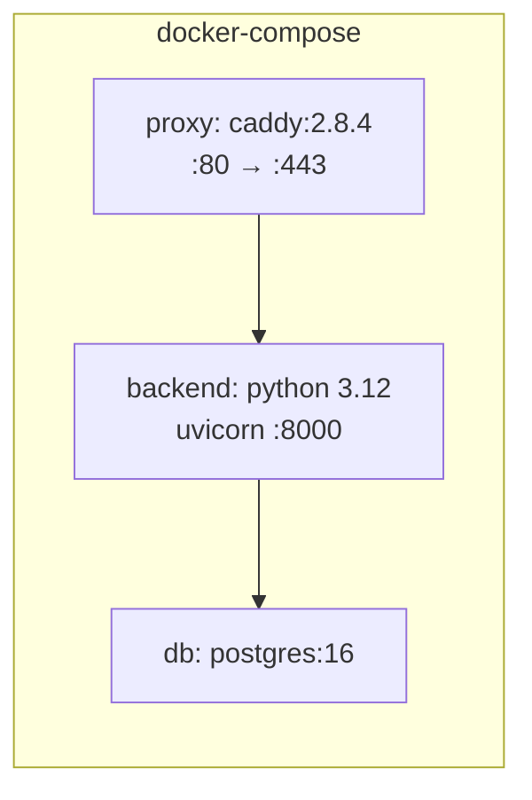

# Architecture Document — VIN-15 Hệ thống hỗ trợ thực tập bằng AI

## System Overview

Một ứng dụng FastAPI phục vụ cả REST API (`/api/v1`) lẫn giao diện SPA tĩnh (`web/`), đứng sau
Caddy (HTTPS). Nghiệp vụ thực tập (hồ sơ, mốc, nhật ký, gia hạn) là state machine viết bằng code;
AI chỉ ở ba chỗ: trợ lý chính sách (LangGraph, có kiểm chứng trích dẫn), trích xuất giấy tiếp
nhận, tóm tắt gợi ý cho giảng viên. Tác tử giám sát chạy theo luật, không gọi LLM.
Chi tiết yêu cầu và trạng thái: `PRD.md`; spec: `.kiro/specs/internship-ai-assistant/`.

## Architecture Diagram

```mermaid
graph TB
    Browser[Trình duyệt<br/>web/app.js] -->|HTTPS| Caddy[Caddy<br/>TLS, HSTS, CSP]
    IdP[IdP OIDC<br/>tùy chọn] -.->|code → userinfo| API
    Caddy --> API

    subgraph Backend[FastAPI — src/]
        API[api/vin15/*<br/>RBAC + scoping] --> WF[workflow/state_machine<br/>transition&#40;&#41; + audit]
        API --> Rules[workflow/rules<br/>cohort.yaml]
        API --> Agent[agents/policy_graph<br/>guard→retrieve→synthesize→verify→finalize]
        API --> Intake[services/intake]
        API --> Reviewer[services/reviewer]
        Monitor[services/monitor<br/>asyncio, hằng ngày + sự kiện] --> Rules
        Monitor --> WF
        Agent --> Index[services/policy_index<br/>BM25 + embedding]
        Agent --> PII[services/pii]
        Intake --> PII
        Reviewer --> PII
    end

    PII -.->|chỉ khi có API key| LLM[OpenAI]
    Index -.->|embedding, khi có key| LLM
    Backend --> DB[(PostgreSQL 16<br/>SQLite khi dev/test)]
    Backend --> Files[(UPLOAD_DIR<br/>file minh chứng)]
```

## Components

| Thành phần | File | Ghi chú |
|---|---|---|
| Giao diện | `web/index.html`, `app.js`, `styles.css` | SPA JS thuần, router hash, không build. Đọc SSE bằng `fetch` + `ReadableStream`. |
| Xác thực | `src/core/security.py`, `auth.py`, `oidc.py` | JWT HS256 (stdlib), PBKDF2; OIDC authorization code tùy chọn. |
| Phân quyền dữ liệu | `src/api/vin15/deps.py` | Mọi truy cập theo id đi qua `load_*`; vi phạm → 403 + audit `access_denied`. |
| State machine | `src/workflow/state_machine.py` | `STATE_GRAPH`, `DECISION_EDGES`; chỉ GV phụ trách (người thật) đi cạnh quyết định. |
| Rule engine | `src/workflow/rules.py`, `config/cohort.yaml` | Luật kiểm tra hồ sơ và giám sát là hàm Python có tên, tham số trong YAML. |
| Trợ lý | `src/agents/policy_graph.py`, `policy_guard.py`, `prompts/policy_assistant.md` | Có `stream_policy_answer` cho SSE; chỉ stream văn bản đã kiểm chứng. |
| Kho quy định | `src/services/policy_index.py` | Tách Chương/Điều/Khoản; lọc hiệu lực phía server; BM25 + cosine. |
| Giám sát | `src/services/monitor.py`, `lifecycle.py` | Cờ không trùng nhờ UNIQUE `open_key`. |
| Lưu vết | `src/core/audit.py`, trigger trong `src/db.py` | `audit_event` append-only ở DB. |

## Data Flow — câu hỏi chính sách

1. `POST /api/v1/assistant/chat/stream` → kiểm tra token, mở hội thoại.
2. `guard`: chặn injection, hỏi dữ liệu người khác; đánh dấu câu hỏi đòi quyết định; che PII.
3. `retrieve`: chỉ văn bản `active` còn hiệu lực hôm nay; BM25 (+ embedding nếu có).
4. `synthesize`: LLM (hoặc trích nguyên văn khi không có key) với marker `[[chunk:id]]`.
5. `verify`: bỏ đoạn có marker lạ; sai hết thì sinh lại 1 lần, rồi trả "không tìm thấy".
6. `finalize`: đánh số nguồn, lưu hội thoại + trích dẫn; SSE gửi `stage` → `delta` → `done`.

## Deployment Architecture

Volume: `pgdata` (DB), `./data` (file), `caddy_data` (chứng chỉ). Backend chỉ mở `127.0.0.1:8000` cho máy local.

## Security

- HTTPS qua Caddy (HSTS, CSP `default-src 'self'`, `X-Frame-Options: DENY`, `nosniff`).
- File tải qua URL ký HMAC, hết hạn 300 s; kiểm định dạng theo magic bytes.
- PII được che trước mọi lời gọi LLM; test quét log ứng dụng không có PII.
- Chưa có: giới hạn tần suất, khóa đăng nhập sai, thu hồi JWT (xem `PRD.md` §13).

## Design Decisions

Xem ADR trong `WORKLOG.md`.

| Decision | Choice | Reason |
|----------|--------|--------|
| Framework | FastAPI + LangGraph | Có sẵn trong template |
| Database | PostgreSQL 16 (prod), SQLite (test) | Một DB cho nghiệp vụ và vector nhỏ; test nhanh, không cần container |
| Frontend | SPA JS thuần | Không cần toolchain Node trong image; vài màn hình CRUD |
| Truy hồi | BM25 + embedding JSON | Kho vài trăm đoạn; tránh phụ thuộc pgvector |
| TLS | Caddy | Tự cấp chứng chỉ (nội bộ hoặc Let's Encrypt), cấu hình một file |
